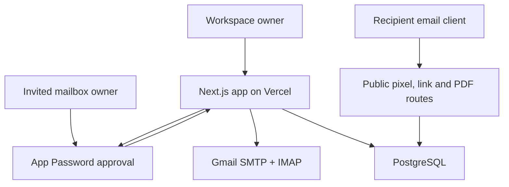

# MailTrack

A consent-based Gmail tracking workspace built with **Next.js, React, TypeScript and PostgreSQL**, ready to deploy on Vercel. A clearly labeled demo is available before configuration; real workspaces start empty.

> **An open is an image request, not proof of reading.** MailTrack can sync existing mailbox metadata, but cannot retroactively add tracking to old messages or automatically modify messages sent directly from Gmail. Open/link tracking applies to emails sent through this app. A Gmail extension or add-on would be a separate integration.

## Features

| Capability             | Implementation and boundaries                                                                                                                                                                                                |
| ---------------------- | ---------------------------------------------------------------------------------------------------------------------------------------------------------------------------------------------------------------------------- |
| Mailbox connection     | Gmail App Password verified through TLS IMAP + SMTP; encrypted credential storage; no OAuth client configuration                                                                                                             |
| Permission invitations | Signed-in owner emails an expiring, one-use approval link. The invitee must authorize the exact invited address. Approval grants the requesting owner mailbox access; it never signs the invitee into the owner’s workspace. |
| Mailbox history        | Resumable full metadata import including inbox, sent, drafts, spam and trash; bounded IMAP sweeps refresh metadata and deletions; plain-text message preview fetched on demand                                               |
| Tracked sending        | Multipart UTF-8 email through Gmail SMTP; unique pixel, link URLs, RFC Message-ID and document links for each intended recipient                                                                                             |
| To / Cc / Bcc          | Up to 20 addresses per composition; one private copy per unique address. All copies use the recipient in To; original recipient category is retained in analytics. **This is not a shared To/Cc group thread.**              |
| Delivery safety        | Atomic message creation, idempotency keys, claimed delivery rows, bounded sending batches, resume controls; ambiguous sends are never automatically resent                                                                   |
| Opens                  | First timestamp, repeated events, full CSV history, recent-activity indicator; proxy/scanner flags are heuristic                                                                                                             |
| Link clicks            | Server-side stored destinations and request events before redirect; only HTTP(S) destinations, up to 30 distinct links per email                                                                                             |
| Tracked PDFs           | Upload up to 3 MB / 200 pages, recipient-specific bearer links, PDF.js canvas viewer, document views, per-page sessions, visible-tab duration, downloads, per-recipient analytics                                            |
| Replies                | Gmail sync matches In-Reply-To/References against sent Message-IDs; deduplicated events                                                                                                                                      |
| Dashboard              | Search, pagination, 7-day chart, full event export, per-message timeline, per-recipient breakdown, timezone preference                                                                                                       |
| Notifications          | Optional desktop notifications while the dashboard is open; dashboard refreshes every 30 seconds. Email digests and closed-browser push notifications are not implemented.                                                   |
| Control                | Delete stored credentials, disconnect and cascade-delete mailbox data, delete PDFs and invalidate links, delete the complete workspace                                                                                       |

The app does **not** identify unknown forwarded recipients, verify forwarding, identify the actual human viewer, reliably report device/location, prove reading comprehension, or predict hiring decisions. Shared links keep attribution to their intended recipient. Caches can hide repeated views; automated requests and your own Sent-folder image loads can create extra events. There is no billing/subscription system or artificial history paywall.

## Deploy to Vercel

### 1. Provision PostgreSQL

Use a PostgreSQL service reachable from Vercel (for example Neon or Supabase PostgreSQL). Obtain the provider’s pooled connection string with its required TLS settings. Do not disable certificate verification.

PDFs are stored as PostgreSQL `bytea` with a 3 MB application limit. This keeps small deployments simple. For large document libraries, migrate binary storage to private object storage and preserve the same authorized download route.

### 2. Prepare a Gmail App Password

No Google Cloud project, Gmail API, OAuth client ID, or client secret is required for new connections.

Enable 2-Step Verification in your Google account and create a dedicated [App Password](https://myaccount.google.com/apppasswords). Do not put this password in Git, screenshots, or chat. Enter it only in the deployed app's `/connect` form. The app verifies IMAP and SMTP authentication without sending a test message and stores the password with AES-256-GCM encryption. Some Workspace policies, Advanced Protection, or 2-Step Verification configurations prevent App Passwords; those accounts cannot use this connection method.

The deployment operator controls the encryption key and can technically decrypt stored credentials. Only connect to a deployment you trust. The application uses read-only IMAP operations, but an App Password itself is not a read-only credential. Deleting an App Password in Google settings invalidates it; disconnecting in MailTrack removes the stored copy and associated data.

Existing OAuth connections remain supported only if the operator retains their Google client credentials. They are optional legacy compatibility, not needed for App Password connections. Existing OAuth users get a separate workspace if signing in through an App Password; no automatic identity merge is performed. To add an App Password connection to an existing workspace, connect while that workspace session is still active.

### 3. Import this repository into Vercel

- Framework: **Next.js**
- Node.js: **24.x** recommended (minimum 22.13)
- Install command: `npm ci`
- Build command: `npm run vercel-build` (configured in `vercel.json`)
- Output: leave the Next.js default
- Use one stable production domain. Set `APP_URL` explicitly for custom domains. Without it, the app uses Vercel’s production project URL (or deployment URL fallback).

Add these server-only environment variables. **Never prefix secrets with `NEXT_PUBLIC_`.**

| Variable               | Value                                                                                                                |
| ---------------------- | -------------------------------------------------------------------------------------------------------------------- |
| `APP_URL`              | Optional on Vercel: exact public origin; otherwise inferred from Vercel system variables                             |
| `DATABASE_URL`         | PostgreSQL connection string                                                                                         |
| `TOKEN_ENCRYPTION_KEY` | 32 random bytes encoded as base64                                                                                    |
| `CRON_SECRET`          | Independent random secret for the cron endpoint                                                                      |
| `ALLOWED_EMAILS`       | Optional comma-separated addresses allowed to create workspaces; set this to your own email for a private deployment |

Generate each secret **independently**:

```bash
openssl rand -base64 32
```

Keep the encryption key stable and backed up securely. Replacing it makes previously stored mailbox credentials unreadable; reconnect mailboxes after an intentional key change. Store credentials in your local untracked `.env.local` or Vercel’s encrypted environment settings, never in Git.

### 4. Deploy — schema initialization is automatic

After setting the environment variables, deploy. The Vercel build validates configuration, runs the test suite, creates a production build, then initializes the schema inside a transaction with an advisory lock. A failed test, build or migration fails deployment. No manual database command is required on Vercel. The database role must be allowed to create tables and indexes.

Use a separate database for preview deployments. Do not point untrusted preview code at your production database. Future schema changes must remain compatible with the previously deployed app because build-time migrations precede traffic promotion.

The standard `npm run build` remains available for offline CI and demo builds. Local development can run `npm run db:migrate` explicitly.

### 5. Connect and verify

1. Open Connect and enter your Gmail address and a dedicated App Password. This also signs you into your workspace.
2. Open **Accounts → Sync mailbox**. Initial import processes 25 messages per request; the UI runs up to 20 batches per click. Progress is saved. Click again for larger mailboxes. IMAP imports up to 25 messages from one folder per request. A completed sweep resets its cursor for the next sweep, refreshing flags and removing deleted messages. New mail and replies may take a complete sweep to appear.
3. To connect another mailbox, send a permission request from Accounts. The owner reviews the disclosure and enters an App Password for the exact invited address.
4. Send a tracked message to a separate test mailbox you control. Include a normal HTTPS link and, optionally, an uploaded PDF.
5. Open it with remote images enabled, click the link and view PDF pages. Confirm the activity timeline and document analytics. A second opening may be cached and therefore may not register.
6. Reply from the recipient account, then sync the sender account. Confirm the reply event.
7. Test denial, expired invitations, revocation, disconnect, and deletion before onboarding other users.

**Public tracking endpoints must be reachable without Vercel deployment protection.** Authentication still protects private workspace APIs. If your deployment requires platform login for every request, recipients cannot fetch tracking pixels or shared documents. Test against the production domain, not a protected preview.

## Local development

```bash
npm ci
cp .env.example .env.local
# Fill the values locally; never commit .env.local.
node --env-file=.env.local scripts/migrate.mjs
npm run dev
```

Open `http://localhost:3000`. Without configuration you can explore the labeled demo. External recipients cannot access localhost tracking URLs. Use a stable HTTPS deployment to test tracking.

`npm run dev` starts Next.js development mode. Preview runners passing `--strictPort` use the existing production build via the compatibility launcher; run `npm run build` before using that preview mode.

## Sync, scheduling and delivery semantics

- The Vercel cron in `vercel.json` runs daily, compatible with Hobby’s daily scheduling constraint. It processes at most three connected mailboxes, one saved batch each, oldest sync first, within a time budget. **It is not continuous or guaranteed real-time sync.**
- The manual Sync button imports more batches and catches up replies. For frequent unattended sync, use a paid scheduler or change the cron on a suitable Vercel plan; retain `Authorization: Bearer CRON_SECRET`.
- Large installations should use a durable worker queue and persistent IMAP listeners. This Vercel implementation uses bounded polling, not IDLE or a background socket. Imports are idempotent and the cursor advances only after completion.
- Concurrent sync requests are guarded by a two-minute lease. If a worker times out, wait for lease expiry before resuming.
- Sending processes up to three pending deliveries per request and stops starting work after 30 seconds. The composer continues until the batch is finished. If navigation or a timeout interrupts it, open the message details and use **Continue pending deliveries**.
- A send timeout can mean Gmail accepted the message. Its status becomes `uncertain`; it is never automatically retried. Sync can reconcile it from the RFC Message-ID in Sent. Check Gmail before composing a replacement.
- Reply matching requires standard reply-reference headers. Some mail software strips them. Mailbox sync preserves message metadata but does not download ordinary attachments; use Gmail to access them.
- Gmail quotas, recipient limits and Google authorization still apply. This app does not guarantee delivery or unlimited sending.

[Vercel cron limits](https://vercel.com/docs/cron-jobs/usage-and-pricing) · [Gmail synchronization](https://developers.google.com/workspace/gmail/api/guides/sync)

## Architecture



- `app/api/auth/password`: credential verification, owner sessions, atomic invitation approval. Legacy OAuth routes remain optional.
- `lib/send.ts`: message creation, per-recipient MIME, idempotency and bounded dispatch.
- `lib/imap-sync.ts`, `lib/mailbox.ts`, `lib/sync.ts`: bounded IMAP sync, SMTP transport, reply correlation, uncertain-send reconciliation.
- `app/t`, `app/l`: image tracking and stored-destination redirects.
- `app/d`, `app/api/public/documents`: PDF viewing, authenticated bearer links and validated event collection.
- `app/api/dashboard`, `messages`, `documents`, `export`: owner-scoped analytics.
- `db/schema.sql`: relational persistence and cascading deletion.
- `components/dashboard.tsx`: workspace UI with explicit demo/real separation.

## Security and retention

- AES-256-GCM token encryption with random nonces; hashed seven-day sessions in HttpOnly/SameSite cookies, Secure in production.
- App Password sign-in checks IMAP and SMTP over TLS, requires explicit consent, and rate-limits attempts by hashed client address and email. Passwords are never returned to the browser, placed in URLs, or logged.
- One-use 24-hour invitations are consumed atomically with account creation; the invitee’s verified email must match exactly.
- Every workspace operation validates ownership server-side. Mutations validate Origin. SQL is parameterized.
- Rate limits live in PostgreSQL, not process memory; tracking tokens are 256-bit random values. Public events are signals that can be fabricated by a person who has a tracking URL; they are never treated as authoritative human identity.
- Email HTML is generated from escaped plain text. Synced mail is previewed as text without loading remote images. CSV formulas are neutralized.
- PDFs are rendered by a patched PDF.js release in a canvas viewer; the app does not invoke embedded PDF scripts. Bearer document links can be forwarded. Delete the document to revoke all links.
- The application does not store recipient IP addresses or raw user agents. Provider infrastructure may retain request logs. Avoid logging URLs containing document or OAuth tokens.
- Disconnecting an App Password connection deletes stored credentials and associated data. To invalidate the password globally, delete it in Google account settings. Workspace deletion removes all owned records and PDFs. Backup retention is controlled by your database provider.

## Verification

```bash
npm run typecheck
npm test
npm run build
npm audit --omit=dev
```

The automated tests include UI component interactions in jsdom and use **PGlite (real embedded PostgreSQL)** for schema and query execution, and stub external Gmail/Google network calls, IMAP/SMTP transports, and the Next cookie adapter. They cover tenant isolation, token encryption, origin enforcement, invitations and state binding, batch/idempotent sends, uncertain-send reconciliation, pixel and click collection, reply matching, full/history sync, expired history, PDF event validation, analytics, CSV export and cascading deletion.

Live App Password authentication, real message delivery, actual Gmail image caching and a deployed Vercel/database combination must be verified with your own credentials after deployment. The dashboard was visually reviewed in the browser preview; subsequent browser interaction checks were blocked by the browser environment, so full browser end-to-end verification is not claimed. Passing local tests is not a guarantee of perfect tracking or production readiness for every scale.

CI runs tests, TypeScript checks, a production build and the production-dependency vulnerability audit for pushes and pull requests.

## Deployment validation status

The original GitHub CI run passed. The updated workflow also starts PostgreSQL 16 and runs schema initialization twice to verify first deployment and repeat deployment. Vercel builds run tests before building and initializing the configured database.

Live App Password authentication, invitation delivery, recipient image loading, PDF rendering in a recipient browser, and production cron execution require a configured deployment and consenting test accounts. These have not been verified against your production services. The app collects mailbox credentials through its secure connection form after deployment. Google client ID and secret are not required.

IMAP visibility is limited to folders exposed by Gmail; expose All Mail, Spam and Trash in IMAP settings for complete coverage. When All Mail is available, it is scanned together with Spam and Trash to avoid duplicate label-folder copies. If it is not available, all selectable folders are scanned, which can show duplicate messages. Previews are limited to messages up to 10 MB and do not download ordinary attachments separately. Gmail SMTP acceptance means the server accepted the message, not proof of inbox delivery.
