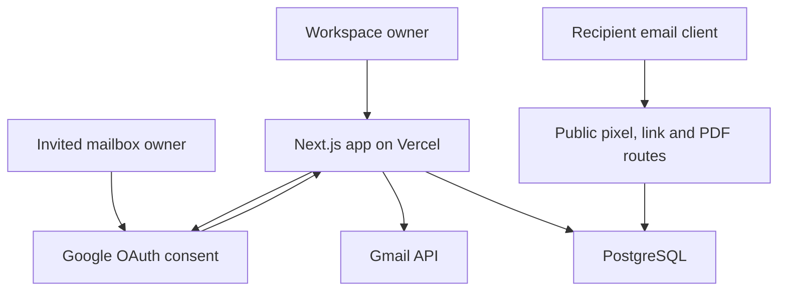

# MailTrack

A consent-based Gmail tracking workspace built with **Next.js, React, TypeScript and PostgreSQL**, ready to deploy on Vercel. A clearly labeled demo is available before configuration; real workspaces start empty.

> **An open is an image request, not proof of reading.** MailTrack can sync existing mailbox metadata, but cannot retroactively add tracking to old messages or automatically modify messages sent directly from Gmail. Open/link tracking applies to emails sent through this app. A Gmail extension or add-on would be a separate integration.

## Features

| Capability             | Implementation and boundaries                                                                                                                                                                                                |
| ---------------------- | ---------------------------------------------------------------------------------------------------------------------------------------------------------------------------------------------------------------------------- |
| Google connection      | OAuth authorization-code flow, PKCE, encrypted state, browser-bound nonce, verified Google identity, read-only + send permissions                                                                                            |
| Permission invitations | Signed-in owner emails an expiring, one-use approval link. The invitee must authorize the exact invited address. Approval grants the requesting owner mailbox access; it never signs the invitee into the owner’s workspace. |
| Mailbox history        | Resumable full metadata import including inbox, sent, drafts, spam and trash; Gmail history-based updates and deletions; plain-text message preview fetched on demand                                                        |
| Tracked sending        | Multipart UTF-8 email through Gmail API; unique pixel, link URLs, RFC Message-ID and document links for each intended recipient                                                                                              |
| To / Cc / Bcc          | Up to 20 addresses per composition; one private copy per unique address. All copies use the recipient in To; original recipient category is retained in analytics. **This is not a shared To/Cc group thread.**              |
| Delivery safety        | Atomic message creation, idempotency keys, claimed delivery rows, bounded sending batches, resume controls; ambiguous sends are never automatically resent                                                                   |
| Opens                  | First timestamp, repeated events, full CSV history, recent-activity indicator; proxy/scanner flags are heuristic                                                                                                             |
| Link clicks            | Server-side stored destinations and request events before redirect; only HTTP(S) destinations, up to 30 distinct links per email                                                                                             |
| Tracked PDFs           | Upload up to 3 MB / 200 pages, recipient-specific bearer links, PDF.js canvas viewer, document views, per-page sessions, visible-tab duration, downloads, per-recipient analytics                                            |
| Replies                | Gmail sync matches In-Reply-To/References against sent Message-IDs; deduplicated events                                                                                                                                      |
| Dashboard              | Search, pagination, 7-day chart, full event export, per-message timeline, per-recipient breakdown, timezone preference                                                                                                       |
| Notifications          | Optional desktop notifications while the dashboard is open; dashboard refreshes every 30 seconds. Email digests and closed-browser push notifications are not implemented.                                                   |
| Control                | Revoke Google access, disconnect and cascade-delete mailbox data, delete PDFs and invalidate links, delete the complete workspace                                                                                            |

The app does **not** identify unknown forwarded recipients, verify forwarding, identify the actual human viewer, reliably report device/location, prove reading comprehension, or predict hiring decisions. Shared links keep attribution to their intended recipient. Caches can hide repeated views; automated requests and your own Sent-folder image loads can create extra events. There is no billing/subscription system or artificial history paywall.

## Deploy to Vercel

### 1. Provision PostgreSQL

Use a PostgreSQL service reachable from Vercel (for example Neon or Supabase PostgreSQL). Obtain the provider’s pooled connection string with its required TLS settings. Do not disable certificate verification.

PDFs are stored as PostgreSQL `bytea` with a 3 MB application limit. This keeps small deployments simple. For large document libraries, migrate binary storage to private object storage and preserve the same authorized download route.

### 2. Configure Google Cloud

1. Create a Google Cloud project and enable **Gmail API**.
2. Configure Google Auth Platform branding/audience. During testing, add **every account that will connect**, including invitees, as a test user.
3. Create an **OAuth client ID → Web application**.
4. Register an authorized redirect URI exactly matching your deployment:
   ```text
   https://YOUR-VERCEL-DOMAIN/api/auth/callback
   ```
   For local development also register `http://localhost:3000/api/auth/callback`.
5. Configure these scopes:
   ```text
   openid
   email
   profile
   https://www.googleapis.com/auth/gmail.readonly
   https://www.googleapis.com/auth/gmail.send
   ```
6. Set the application home page and privacy page (`/privacy`). Replace the operator notice in `app/privacy/page.tsx` with your organization and a real privacy contact before inviting external users.

`gmail.readonly` is a **restricted scope**. Public production use can require Google verification and, when restricted Gmail data is stored/transmitted on a server, a security assessment. A testing-mode app is suitable for configured test users; Gmail testing-mode refresh tokens can expire after seven days. Workspace administrators can also block an app. These are Google requirements, not something this code bypasses.

Official references: [Gmail scopes](https://developers.google.com/workspace/gmail/api/auth/scopes), [OAuth web-server flow](https://developers.google.com/identity/protocols/oauth2/web-server), [OAuth production requirements](https://developers.google.com/identity/protocols/oauth2/production-readiness/policy-compliance).

### 3. Import this repository into Vercel

- Framework: **Next.js**
- Node.js: **24.x** recommended (minimum 22.13)
- Install command: `npm ci`
- Build command: `npm run build`
- Output: leave the Next.js default
- Use one stable production domain. Preview deployments need their own matching OAuth redirect URI and `APP_URL` if you want OAuth there.

Add these server-only environment variables. **Never prefix secrets with `NEXT_PUBLIC_`.**

| Variable               | Value                                                                                                                |
| ---------------------- | -------------------------------------------------------------------------------------------------------------------- |
| `APP_URL`              | Your exact public origin, e.g. `https://mailtrack.example.com`                                                       |
| `DATABASE_URL`         | PostgreSQL connection string                                                                                         |
| `GOOGLE_CLIENT_ID`     | Google web OAuth client ID                                                                                           |
| `GOOGLE_CLIENT_SECRET` | Google client secret                                                                                                 |
| `TOKEN_ENCRYPTION_KEY` | 32 random bytes encoded as base64                                                                                    |
| `CRON_SECRET`          | Independent random secret for the cron endpoint                                                                      |
| `ALLOWED_EMAILS`       | Optional comma-separated addresses allowed to create workspaces; set this to your own email for a private deployment |

Generate each secret **independently**:

```bash
openssl rand -base64 32
```

Keep the encryption key stable and backed up securely. Replacing it makes previously stored Google tokens unreadable; reconnect mailboxes after an intentional key change. Store credentials in your local untracked `.env.local` or Vercel’s encrypted environment settings, never in Git.

### 4. Initialize the database

Run from a local clone with the production `DATABASE_URL` supplied securely in your shell, or put it in an untracked `.env.local`:

```bash
npm ci
node --env-file=.env.local scripts/migrate.mjs
```

Alternatively run `npm run db:migrate` when `DATABASE_URL` is already exported. The schema migration uses a transaction and advisory lock. Run it against a fresh database before first sign-in. It can safely be rerun. Do not run schema changes automatically in every serverless invocation.

Redeploy after configuring environment variables. Open the app and click **Connect your Gmail**. If setup is missing, the app shows a setup dialog instead of pretending to connect.

### 5. Connect and verify

1. Approve Google read and send permissions for your own account.
2. Open **Accounts → Sync mailbox**. Initial import processes 25 messages per request; the UI runs up to 20 batches per click. Progress is saved. Click again for larger mailboxes. New activity is caught up using Gmail history after full import.
3. To connect another mailbox, send a permission request from Accounts. The owner reviews the disclosure and signs in to the invited Google address.
4. Send a tracked message to a separate test mailbox you control. Include a normal HTTPS link and, optionally, an uploaded PDF.
5. Open it with remote images enabled, click the link and view PDF pages. Confirm the activity timeline and document analytics. A second opening may be cached and therefore may not register.
6. Reply from the recipient account, then sync the sender account. Confirm the reply event.
7. Test denial, expired invitations, revocation, disconnect, and deletion before onboarding other users.

**Public tracking endpoints must be reachable without Vercel deployment protection.** Authentication still protects private workspace APIs. If your deployment requires platform login for every request, recipients cannot fetch tracking pixels or shared documents. Test against the production domain, not a protected preview.

## Local development

```bash
npm ci
cp .env.example .env.local
# Fill the values locally; never commit .env.local.
node --env-file=.env.local scripts/migrate.mjs
npm run dev
```

Open `http://localhost:3000`. Without configuration you can explore the labeled demo. External recipients cannot access localhost tracking URLs. Use a stable HTTPS deployment to test tracking.

`npm run dev` starts Next.js development mode. Preview runners passing `--strictPort` use the existing production build via the compatibility launcher; run `npm run build` before using that preview mode.

## Sync, scheduling and delivery semantics

- The Vercel cron in `vercel.json` runs daily, compatible with Hobby’s daily scheduling constraint. It processes at most three connected mailboxes, one saved batch each, oldest sync first, within a time budget. **It is not continuous or guaranteed real-time sync.**
- The manual Sync button imports more batches and catches up replies. For frequent unattended sync, use a paid scheduler or change the cron on a suitable Vercel plan; retain `Authorization: Bearer CRON_SECRET`.
- Large installations should use a durable job queue and Gmail Pub/Sub watch notifications. This repository does not configure Pub/Sub or an external queue. A very large history batch can be retried after timeout because imports are idempotent and the cursor advances only after completion.
- Concurrent sync requests are guarded by a two-minute lease. If a worker times out, wait for lease expiry before resuming.
- Sending processes up to three pending deliveries per request and stops starting work after 30 seconds. The composer continues until the batch is finished. If navigation or a timeout interrupts it, open the message details and use **Continue pending deliveries**.
- A send timeout can mean Gmail accepted the message. Its status becomes `uncertain`; it is never automatically retried. Sync can reconcile it from the RFC Message-ID in Sent. Check Gmail before composing a replacement.
- Reply matching requires standard reply-reference headers. Some mail software strips them. Mailbox sync preserves message metadata but does not download ordinary attachments; use Gmail to access them.
- Gmail quotas, recipient limits and Google authorization still apply. This app does not guarantee delivery or unlimited sending.

[Vercel cron limits](https://vercel.com/docs/cron-jobs/usage-and-pricing) · [Gmail synchronization](https://developers.google.com/workspace/gmail/api/guides/sync)

## Architecture



- `app/api/auth`: Google OAuth, owner sessions, logout.
- `lib/send.ts`: message creation, per-recipient MIME, idempotency and bounded dispatch.
- `lib/sync.ts`: full and incremental Gmail sync, reply correlation, uncertain-send reconciliation.
- `app/t`, `app/l`: image tracking and stored-destination redirects.
- `app/d`, `app/api/public/documents`: PDF viewing, authenticated bearer links and validated event collection.
- `app/api/dashboard`, `messages`, `documents`, `export`: owner-scoped analytics.
- `db/schema.sql`: relational persistence and cascading deletion.
- `components/dashboard.tsx`: workspace UI with explicit demo/real separation.

## Security and retention

- AES-256-GCM token encryption with random nonces; hashed seven-day sessions in HttpOnly/SameSite cookies, Secure in production.
- OAuth state expires after ten minutes, is encrypted, bound to a browser nonce and uses PKCE. Reconnecting into an existing workspace also checks its active session.
- One-use 24-hour invitations are consumed atomically with account creation; the invitee’s verified email must match exactly.
- Every workspace operation validates ownership server-side. Mutations validate Origin. SQL is parameterized.
- Rate limits live in PostgreSQL, not process memory; tracking tokens are 256-bit random values. Public events are signals that can be fabricated by a person who has a tracking URL; they are never treated as authoritative human identity.
- Email HTML is generated from escaped plain text. Synced mail is previewed as text without loading remote images. CSV formulas are neutralized.
- PDFs are rendered by a patched PDF.js release in a canvas viewer; the app does not invoke embedded PDF scripts. Bearer document links can be forwarded. Delete the document to revoke all links.
- The application does not store recipient IP addresses or raw user agents. Provider infrastructure may retain request logs. Avoid logging URLs containing document or OAuth tokens.
- Disconnecting revokes Google access before deleting associated data. Revocation can invalidate the same Google grant in another workspace, which is marked for reconnection. Workspace deletion removes all owned records and PDFs. Backup retention is controlled by your database provider.

## Verification

```bash
npm run typecheck
npm test
npm run build
npm audit --omit=dev
```

The 35 automated tests include UI component interactions in jsdom and use **PGlite (real embedded PostgreSQL)** for schema and query execution, and stub only external Gmail/Google network calls and the Next cookie adapter. They cover tenant isolation, token encryption, origin enforcement, invitations and state binding, batch/idempotent sends, uncertain-send reconciliation, pixel and click collection, reply matching, full/history sync, expired history, PDF event validation, analytics, CSV export and cascading deletion.

Google’s live consent screens, real message delivery, actual Gmail image caching and a deployed Vercel/database combination must be verified with your own credentials after deployment. The dashboard was visually reviewed in the browser preview; subsequent browser interaction checks were blocked by the browser environment, so full browser end-to-end verification is not claimed. Passing local tests is not a guarantee of perfect tracking or production readiness for every scale.

CI runs tests, TypeScript checks, a production build and the production-dependency vulnerability audit for pushes and pull requests.
